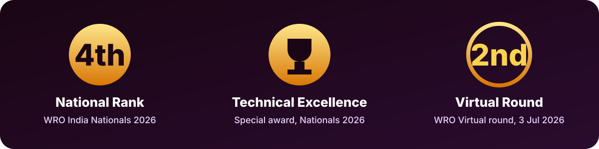
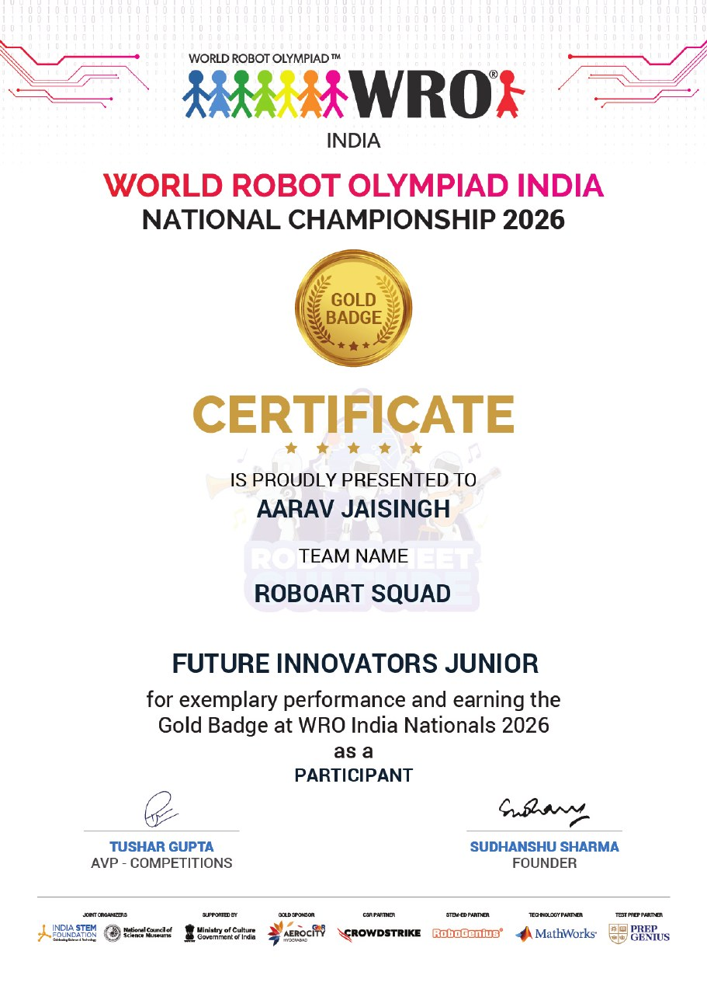
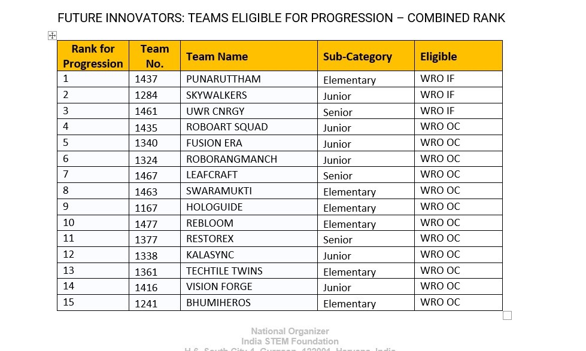
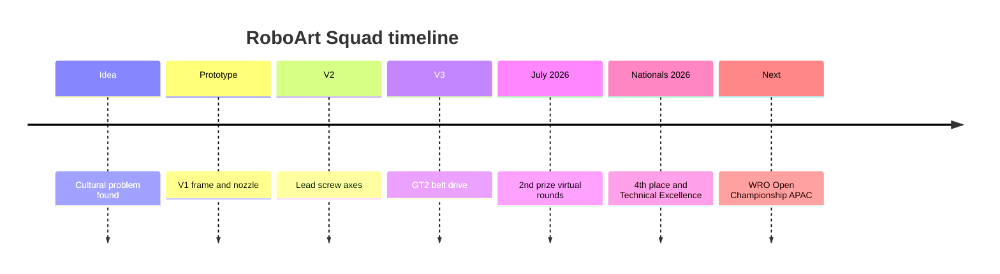
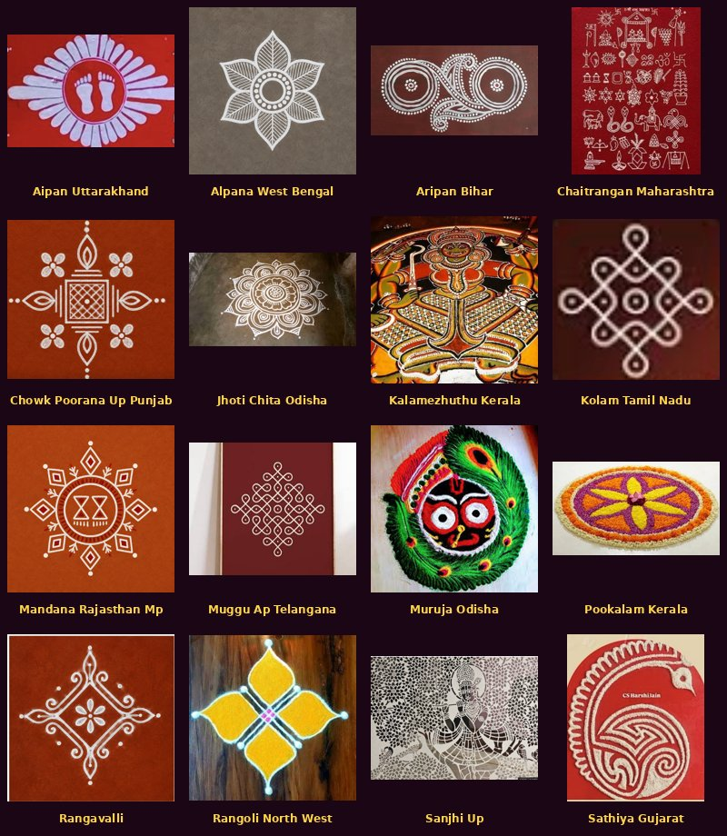
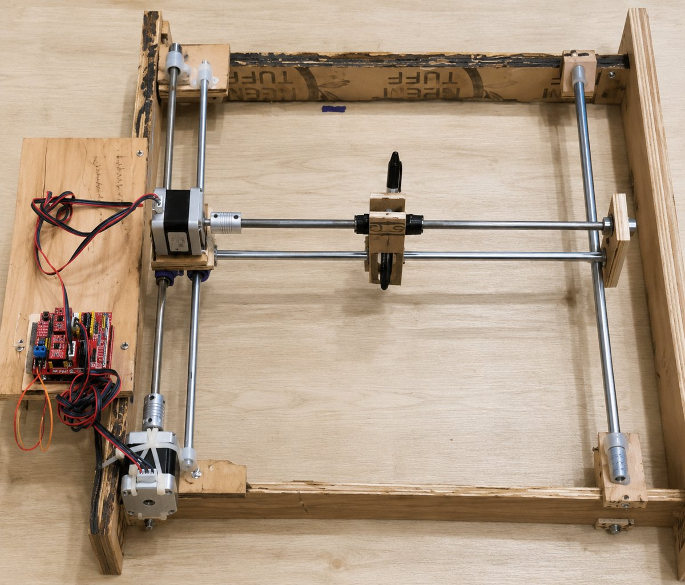
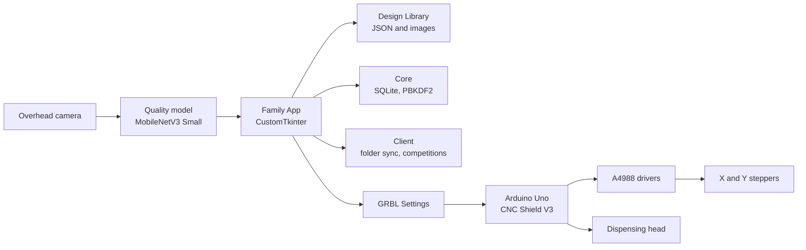
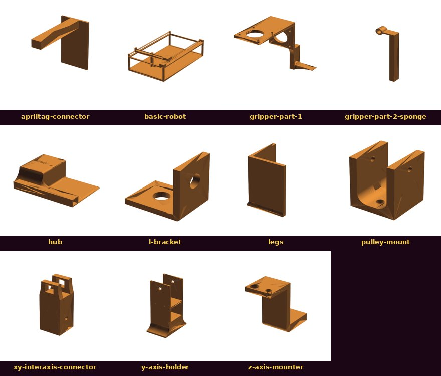
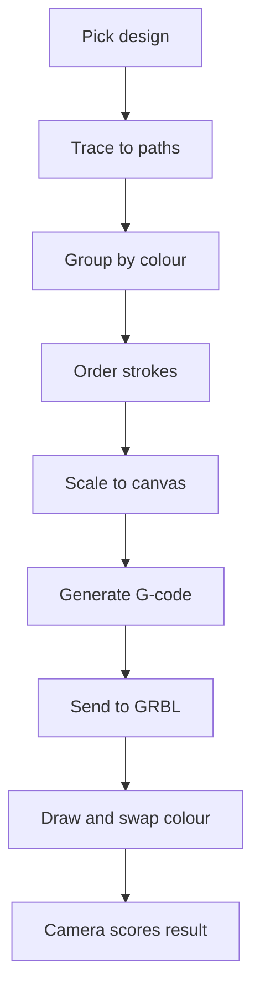

<p align="center">
  
</p>

<p align="center">
  
  
  
  
  
  
  
</p>

<h1 align="center">RoboArt-Squad</h1>
<h3 align="center">Team 1435, WRO India Nationals 2026<br>Bharat Art-Bot: an autonomous robot that draws rangoli and kolam</h3>

<p align="center">
  <a href="#1-overview">Overview</a> |
  <a href="#2-awards-and-recognition">Awards</a> |
  <a href="#9-hardware">Hardware</a> |
  <a href="#10-cad-files">CAD</a> |
  <a href="#11-software">Software</a> |
  <a href="#16-run-it-yourself">Run it</a> |
  <a href="#21-faq">FAQ</a>
</p>

---

## Table of Contents

1. [Overview](#1-overview)
2. [Awards and Recognition](#2-awards-and-recognition)
3. [Our Journey](#3-our-journey)
4. [The Problem](#4-the-problem)
5. [Research](#5-research)
6. [The Solution](#6-the-solution)
7. [Robot Versions](#7-robot-versions)
8. [System Architecture](#8-system-architecture)
9. [Hardware](#9-hardware)
10. [CAD Files](#10-cad-files)
11. [Software](#11-software)
12. [Design Library](#12-design-library)
13. [Drawing Pipeline](#13-drawing-pipeline)
14. [Calibration and GRBL](#14-calibration-and-grbl)
15. [Repository Navigation](#15-repository-navigation)
16. [Run It Yourself](#16-run-it-yourself)
17. [Configuration Reference](#17-configuration-reference)
18. [Testing Checklist](#18-testing-checklist)
19. [Troubleshooting](#19-troubleshooting)
20. [Impact and Roadmap](#20-impact-and-roadmap)
21. [FAQ](#21-faq)
22. [Contributing](#22-contributing)
23. [Safety](#23-safety)
24. [Team and Credits](#24-team-and-credits)

---

## 1. Overview

**Bharat Art-Bot** is a Cartesian gantry robot that draws rangoli and kolam patterns on the floor using coloured powder. It was built by **Team 1435 (RoboArt Squad)** for the **World Robot Olympiad (WRO) India Nationals 2026**.

Rangoli and kolam are living art forms. They are drawn fresh at the doorstep, often every morning. Fewer young people learn them each year, and the people who know the complex patterns are ageing. Our robot does two jobs:

- It **draws** designs fast and cleanly in powder, in multiple colours.
- It **teaches** designs through a companion app with a design library, family accounts and competitions.

| Item | Detail |
|---|---|
| Team | 1435, RoboArt Squad |
| Event | WRO India Nationals 2026 |
| Result | 4th place and Technical Excellence Award |
| Virtual rounds | 2nd prize (3 July 2026) |
| Next | Invited to WRO Open Championship APAC |
| Motion | Cartesian gantry, GT2 belts, 2020 V-slot |
| Controller | Arduino Uno, CNC Shield V3, A4988 drivers, GRBL |
| Colours | Red, Green, Yellow powder docks |
| Software | Python 3.13, CustomTkinter, SQLite, TensorFlow |

---

## 2. Awards and Recognition

<p align="center">
  
</p>

| Award | Event | Date |
|---|---|---|
| Technical Excellence Award | WRO India Nationals 2026 | 2026 |
| 4th place overall | WRO India Nationals 2026 | 2026 |
| 2nd prize, virtual rounds | WRO 2026 virtual rounds | 3 July 2026 |
| Gold badge | WRO India Nationals 2026 | 2026 |
| Invitation | WRO Open Championship APAC | 2026 |

<p align="center">
  
  
</p>

The signed certificate is in [`Docs/certificates`](Docs/certificates/WRO-India-Nationals-2026-Gold-Badge-Aarav-Jaisingh.pdf).

---

## 3. Our Journey

| Stage | What happened |
|---|---|
| Idea | Notice that fewer children learn kolam and rangoli at home |
| Prototype | First robot with a simple frame and a hand-fed powder nozzle |
| Lead screw build | Version 2 moved the axes on lead screws |
| Belt drive build | Version 3 switched to GT2 belts for speed |
| Software | Family app, design library, GRBL tuning tools |
| Virtual rounds | 2nd prize, 3 July 2026 |
| Nationals | 4th place and Technical Excellence Award |
| Next | WRO Open Championship APAC |



---

## 4. The Problem

1. **Skill loss.** Complex kolam grids and rangoli symmetry are hard to learn without a patient teacher.
2. **Time.** A detailed design takes an adult 30 to 60 minutes by hand.
3. **Consistency.** Hand drawn lines vary in width and spacing.
4. **Access.** Families that live far apart cannot easily share designs or compete.

We asked: can a robot do the repetitive drawing so people can focus on creating and learning designs?

---

## 5. Research

We studied three things before building.

### 5.1 The art

- Kolam: continuous line patterns wrapped around a dot grid.
- Rangoli: filled colour patterns, often radially symmetric.
- Both use symmetry, repetition and closed loops, which suits a plotter.

### 5.2 Existing machines

| Approach | Strength | Weakness |
|---|---|---|
| Hand drawing | Cultural value | Slow, varies |
| Stencil and powder | Quick | One design per stencil |
| Pen plotter | Precise | Cannot dispense powder |
| Our gantry | Any design, multi colour | Needs calibration |

### 5.3 Dispensing

Powder flows unevenly. We tested nozzle sizes, belt speeds and vibration. The result is a belt based dispensing system that gives a steady line at working speed.

---

## 6. The Solution

Three parts work together:

1. **Robot.** A gantry that moves a dispensing head over a 600 x 1000 mm area.
2. **Colour docks.** Three powder docks (Red, Green, Yellow). The head swaps colour between strokes.
3. **App.** A desktop app to pick designs, preview, send to the robot, track progress, and share with family.

<p align="center">
  
</p>

---

## 7. Robot Versions

| Version | Drive | Result |
|---|---|---|
| V1 prototype | Simple frame | Proved the idea, slow and wobbly |
| V2 | Lead screws | Accurate, too slow |
| V3 | GT2 belts, 2020 V-slot | Fast and accurate, used at Nationals |

<p align="center">
  
  
  
</p>
<p align="center"><sub>V1 prototype, V2 lead screw, V3 belt drive</sub></p>

---

## 8. System Architecture



### Layers

| Layer | Role |
|---|---|
| UI | `family_ui.py`, screens and navigation |
| Core | `family_core.py`, accounts, password hashing, storage |
| Client | `family_client.py`, sync and competitions |
| Machine | `grbl_settings.py`, motion parameters |
| Vision | `Tensorflow_eval-training.py`, scores drawings |

---

## 9. Hardware

### 9.1 Bill of main parts

| Part | Use |
|---|---|
| 2020 V-slot extrusion | Frame and gantry rails |
| GT2 belt and pulleys | X and Y motion |
| NEMA 17 steppers | Axis drive |
| Arduino Uno | Runs GRBL |
| CNC Shield V3 | Stepper driver base |
| A4988 drivers | Stepper control |
| Limit switches | Homing |
| Powder docks x3 | Red, Green, Yellow |
| Overhead camera | Quality scoring |
| 3D printed parts | Brackets, mounts, gripper, hub |

### 9.2 Wiring summary

| Signal | Board |
|---|---|
| X step and dir | CNC Shield X |
| Y step and dir | CNC Shield Y |
| Z or dock lift | CNC Shield Z |
| Limit switches | Shield limit pins |
| Power | 12 V supply to shield |

### 9.3 Assembly order

1. Build the frame from 2020 extrusion.
2. Mount the Y rails and the Y axis holders.
3. Fit the X gantry using the XY inter-axis connector.
4. Install pulleys with the pulley mounts and run GT2 belts.
5. Mount motors and limit switches.
6. Fit the Z axis mounter and dispensing head.
7. Install the powder docks.
8. Wire the shield, flash GRBL, set parameters.
9. Home, calibrate, test.

---

## 10. CAD Files

All parts are in [`Hardware/CAD`](Hardware/CAD) as STL, ready to slice and print. Parts follow the structure of the Humanoid Operating System hardware set from [Aarav-111/Humanoid-Operating-System](https://github.com/Aarav-111/Humanoid-Operating-System).

<p align="center">
  
</p>

| File | Size mm (X x Y x Z) | Triangles | Use |
|---|---|---|---|
| `basic-robot.stl` | 600 x 1000 x 380 | 4310 | Full robot reference model |
| `hub.stl` | 180 x 126 x 71 | 8948 | Central hub |
| `gripper-part-1.stl` | 72 x 98 x 97 | 1640 | Gripper body |
| `gripper-part-2-sponge.stl` | 27 x 10 x 85 | 292 | Soft gripper pad |
| `z-axis-mounter.stl` | 50 x 107 x 117.5 | 380 | Z axis mount |
| `xy-interaxis-connector.stl` | 50 x 50 x 145 | 212 | Joins X and Y |
| `pulley-mount.stl` | 30 x 30 x 40 | 792 | Belt pulley seat |
| `y-axis-holder.stl` | 25 x 40 x 76 | 404 | Y rail holder |
| `l-bracket.stl` | 51 x 40 x 54 | 464 | Frame bracket |
| `legs.stl` | 62 x 62 x 100 | 180 | Frame feet |
| `apriltag-connector.stl` | 30 x 62 x 65 | 28 | Marker mount |

Previews are in [`assets/cad`](assets/cad). A reference gantry document is at [`Hardware/Gantry-Reference-HOS-Documentation-v3.0.pdf`](Hardware/Gantry-Reference-HOS-Documentation-v3.0.pdf).

### Print settings (suggested)

| Setting | Value |
|---|---|
| Material | PLA or PETG |
| Layer height | 0.2 mm |
| Walls | 3 |
| Infill | 25 to 40 percent for brackets |
| Supports | Only where needed |

---

## 11. Software

All code is in [`Software`](Software).

| File | Purpose |
|---|---|
| `family_core.py` | SQLite storage, accounts, PBKDF2 password hashing |
| `family_client.py` | Mailbox folder sync every 45 s, competitions |
| `family_ui.py` | CustomTkinter interface |
| `grbl_settings.py` | Steps per mm, axis ratio, rate cap, arc tolerance |
| `Tensorflow_eval-training.py` | Trains the drawing quality model |
| `config/*.json` | Nine configuration files |
| `models/hand_landmarker.task` | Hand tracking model |

### 11.1 Family accounts

Each family has an account. Passwords are hashed with PBKDF2. Data stays in a local SQLite database that is ignored by git.

### 11.2 Mailbox sync

Families share designs and competition entries through a shared folder. The client checks it every 45 seconds. No cloud account is needed.

### 11.3 Competitions

Members submit a design, the model scores it, and the app shows a leaderboard.

### 11.4 Quality model

A MobileNetV3 Small network with three heads:

| Head | Measures |
|---|---|
| Symmetry | How balanced the pattern is |
| Line quality | Evenness and continuity of lines |
| Colour harmony | How well the colours work together |

---

## 12. Design Library

[`Designs/traditional_designs`](Designs/traditional_designs) holds **48 images across 16 traditional styles**. [`Designs/My Designs`](Designs/My%20Designs) holds three custom JSON designs.

Designs are converted to stroke paths, grouped by colour, and ordered to reduce travel.

---

## 13. Drawing Pipeline



| Step | Detail |
|---|---|
| Trace | Convert image to centre lines |
| Colour group | Red, Green, Yellow |
| Order | Nearest neighbour to cut travel |
| Scale | Fit the 600 x 1000 mm canvas |
| G-code | Lines and arcs within arc tolerance |
| Send | Streaming with feed rate cap |
| Score | Symmetry, line quality, colour harmony |

---

## 14. Calibration and GRBL

Set these in GRBL with `$` commands (see `grbl_settings.py`).

| Setting | Meaning |
|---|---|
| Steps per mm X and Y | From pulley teeth, belt pitch, microstepping |
| Axis ratio | Corrects X versus Y scale differences |
| Rate cap | Maximum feed so powder stays steady |
| Arc tolerance | Smoothness of curves |

### Steps per mm formula

```
steps_per_mm = (motor_steps_per_rev x microstepping) / (belt_pitch_mm x pulley_teeth)
```

Example: 200 steps, 16x microstepping, GT2 2 mm pitch, 20 teeth gives 80 steps per mm.

### Calibration routine

1. Home the machine.
2. Draw a 200 mm square.
3. Measure both sides.
4. Adjust steps per mm until the square is exact.
5. Draw a circle and check it is round, then tune the axis ratio.
6. Lower the rate cap until line width is steady.

---

## 15. Repository Navigation

```
RoboArt-Squad/
  README.md
  LICENSE
  .gitignore
  assets/            hero, badges, photos, CAD previews
  Designs/
    traditional_designs/   48 images, 16 styles
    My Designs/            3 JSON designs
  Docs/certificates/       Gold badge certificate
  Hardware/
    CAD/                   11 STL files
    Gantry-Reference-HOS-Documentation-v3.0.pdf
  Software/
    family_core.py
    family_client.py
    family_ui.py
    grbl_settings.py
    Tensorflow_eval-training.py
    config/                9 JSON files
    models/                hand_landmarker.task
```

---

## 16. Run It Yourself

### Requirements

| Need | Version |
|---|---|
| Python | 3.13 |
| OS | Windows, macOS or Linux |
| Robot | Optional, the app runs without it |

### Install

```bash
git clone https://github.com/Aarav-111/RoboArt-Squad.git
cd RoboArt-Squad/Software
python -m venv .venv
# Windows: .venv\Scripts\activate
source .venv/bin/activate
pip install customtkinter pillow numpy pyserial tensorflow mediapipe
```

### Start

```bash
python family_ui.py
```

### Connect the robot

1. Flash GRBL to the Arduino Uno.
2. Plug in USB and pick the serial port in the app.
3. Home the machine, then run a test design.

---

## 17. Configuration Reference

Configuration lives in `Software/config`. Files with secrets or personal data are git ignored.

| Item | Where |
|---|---|
| Machine settings | `grbl_settings.py` |
| App settings | `config/*.json` |
| API key | `openai_key.txt` (never committed) |
| Local data | `*.db` (never committed) |

---

## 18. Testing Checklist

| Check | Pass condition |
|---|---|
| Homing | All axes reach limit and stop |
| Square test | 200 mm square within 1 mm |
| Circle test | Round, no flat sides |
| Colour swap | Each dock dispenses cleanly |
| Line quality | No gaps or blobs |
| App sync | Shared folder updates within 45 s |
| Login | Wrong password rejected |

---

## 19. Troubleshooting

| Symptom | Likely cause | Fix |
|---|---|---|
| Axis drifts | Loose belt or pulley | Tighten, re-seat grub screw |
| Wrong scale | Steps per mm off | Recalibrate |
| Oval circles | Axis ratio off | Tune axis ratio |
| Gaps in lines | Damp or clumped powder | Sieve and dry powder |
| Blobs at corners | Speed too high | Lower rate cap |
| No serial port | Driver or cable | Reinstall CH340 driver, change cable |
| Motors buzz | Low driver current | Adjust A4988 reference voltage |

---

## 20. Impact and Roadmap

### Impact

- Keeps rangoli and kolam visible to a new generation.
- Saves time for busy families.
- Gives a safe way to practise complex designs.

### Roadmap

| Item | Status |
|---|---|
| WRO Open Championship APAC | Invited |
| Faster dispensing | Planned |
| More colours | Planned |
| `App_v16.py` full app | Coming |
| Mobile viewer | Idea |

---

## 21. FAQ

**Does it need the internet?** No. Sync uses a shared folder.

**How long does a design take?** Depends on the pattern. Simple designs take a few minutes.

**Which colours?** Red, Green and Yellow docks.

**Can I add my own design?** Yes, add a JSON file in `Designs/My Designs`.

**Can I print the parts?** Yes, see section 10.

**Why Arduino and GRBL?** Cheap, reliable, well documented.

---

## 22. Contributing

1. Fork the repo.
2. Create a branch.
3. Make a small, focused change.
4. Open a pull request with a clear description.

Ideas welcome: new designs, calibration tools, dispensing improvements.

---

## 23. Safety

- Keep hands clear while the gantry moves.
- Keep an emergency stop within reach.
- Use non-toxic powder and avoid inhaling dust.
- Keep power wiring covered and dry.
- Supervise children near the robot.

---

## 24. Team and Credits

| Name | Role |
|---|---|
| Aarav Jaisingh | Lead engineer, software and robotics |
| Team 1435 | RoboArt Squad |
| Prolabs Robotics | Organisation |

Hardware structure inspired by [Humanoid Operating System](https://github.com/Aarav-111/Humanoid-Operating-System).

**Contact:** prolabsrobotics@gmail.com

Licensed under MIT. See [LICENSE](LICENSE).

<p align="center"><sub>Built by Team 1435 for WRO India Nationals 2026. Invited to WRO Open Championship APAC.</sub></p>
