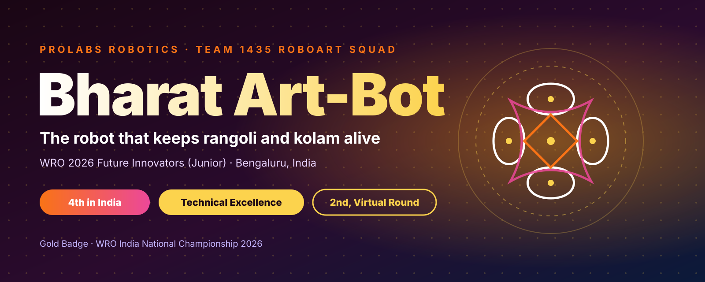
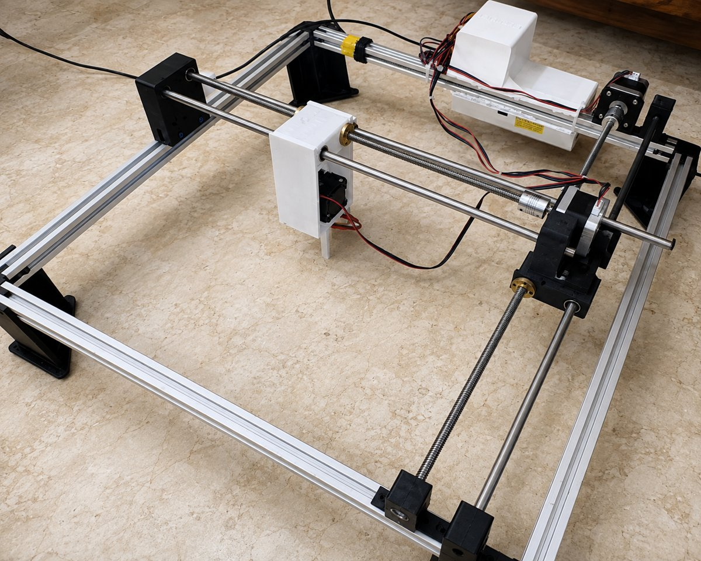
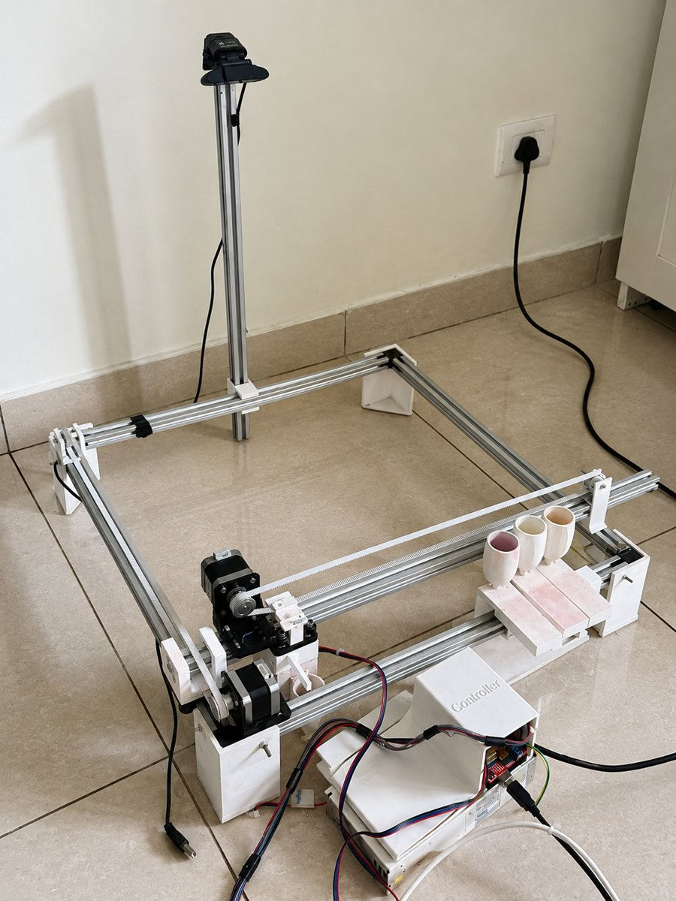
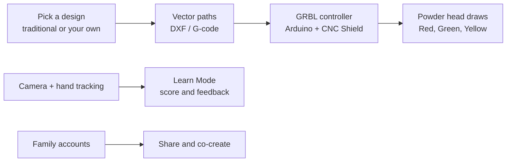

<p align="center">
  
</p>

<p align="center">
  <a href="#awards"></a>
  <a href="#awards"></a>
  <a href="#awards"></a>
  <a href="#awards"></a>
  <a href="Software"></a>
  <a href="Software/grbl_settings.py"></a>
  <a href="LICENSE"></a>
</p>

<p align="center">
  <a href="#awards"><b>Awards</b></a> &nbsp;|&nbsp; <a href="#the-problem"><b>Problem</b></a> &nbsp;|&nbsp; <a href="#robot-journey"><b>Robot Journey</b></a> &nbsp;|&nbsp; <a href="#how-it-works"><b>How It Works</b></a> &nbsp;|&nbsp; <a href="#navigate-this-repository"><b>Navigate</b></a> &nbsp;|&nbsp; <a href="#run-it"><b>Run It</b></a> &nbsp;|&nbsp; <a href="#hardware"><b>Hardware</b></a> &nbsp;|&nbsp; <a href="#team-and-contact"><b>Team</b></a>
</p>

---

## Overview

> ### Every Indian doorstep once had a rangoli.
> Grandmothers drew kolam at dawn and taught it to the next generation, line by line.
>
> **Today many grandmothers can no longer bend to the floor, and families live too far apart to keep teaching.**
>
> Bharat Art-Bot is an autonomous CNC robot that draws traditional rangoli and kolam in real coloured powder, and an app that helps families learn, share and co-create designs together.

Invited to the **WRO Open Championship, Asia Pacific (APAC)**.

Built by **Team 1435, RoboArt Squad** for the **World Robot Olympiad (WRO) 2026, Future Innovators, Junior** category. Part of Prolabs Robotics, Bengaluru, India.

---

## Awards

<p align="center">
  
</p>

| Result | Event | Date |
| --- | --- | --- |
| **4th in India** | WRO India National Championship 2026, Future Innovators Junior | 28 Aug 2026 |
| **Technical Excellence award** | Special award, WRO India Nationals 2026 | 28 Aug 2026 |
| **Gold Badge** | WRO India National Championship 2026 | Aug 2026 |
| **2nd place** | WRO Virtual round | 3 Jul 2026 |
| **Invited** | WRO Open Championship, Asia Pacific (APAC), Hyderabad | Sep 2026 |

<table align="center">
  <tr>
    <td align="center" width="50%">
      
      <br><b>Gold Badge certificate</b><br>WRO India Nationals 2026
    </td>
    <td align="center" width="50%">
      
      <br><b>Rank 4, Future Innovators</b><br>Official progression list, WRO India
    </td>
  </tr>
</table>

---

## The Problem

Rangoli and kolam are passed down by hand, from grandmother to child. That chain is breaking:

| Barrier | What happens |
| --- | --- |
| Physical | Elderly women often cannot sit or bend on the floor to draw for long |
| Distance | Urban nuclear families live far from grandparents |
| Time | Busy schedules leave no daily practice time |
| Interest | Children see it as hard and slow, so they stop |

We ran a survey of 20 grandmothers and interviews with families to shape the solution.

---

## Robot Journey

<table align="center">
  <tr>
    <td align="center" width="33%">
      
      <br><b>Version 1</b><br>Wooden frame, pen plotter
    </td>
    <td align="center" width="33%">
      
      <br><b>Version 2</b><br>2020 V-slot frame, lead screws
    </td>
    <td align="center" width="33%">
      
      <br><b>Version 3 (Nationals)</b><br>GT2 belt drive, 3 colour docks, camera
    </td>
  </tr>
</table>

---

## How It Works



| Feature | What it does |
| --- | --- |
| Draw | Draws rangoli and kolam with real coloured powder from 3 docks |
| Traditional library | 48 reference designs from 16 regional styles across India |
| Learn Mode | Step-by-step lessons on symmetry, scored with camera feedback |
| Family | Local accounts, families, invites and shared designs |
| Kid mode | Simple, friendly interface with sounds |
| Languages | UI translations, including Gujarati and other Indian languages |

---

## Navigate This Repository

| Folder | What you will find |
| --- | --- |
| [Software](Software) | Family system, GRBL tools and the ML training script |
| [Software/config](Software/config) | App settings: camera, colour docks, infill, language, kid mode |
| [Software/models](Software/models) | `hand_landmarker.task` for hand tracking in Learn Mode |
| [Designs/traditional_designs](Designs/traditional_designs) | 48 regional reference designs (Kolam, Alpana, Muggu, Pookalam and more) |
| [Designs/My Designs](Designs/My%20Designs) | Sample saved notebook pages |
| [Docs/certificates](Docs/certificates) | Nationals 2026 Gold Badge certificate |
| [assets](assets) | Banners, badges and photos |

### File index

| File | Purpose |
| --- | --- |
| `Software/family_core.py` | SQLite storage for users, families, invites and shares. Passwords hashed with PBKDF2-SHA256 |
| `Software/family_client.py` | Sign-in, sync and sharing logic on top of `family_core` |
| `Software/family_ui.py` | Tkinter / CustomTkinter popups for the Family sign-in and hub |
| `Software/grbl_settings.py` | Reads and fixes GRBL steps/mm, axis ratio, max rate and arc tolerance over serial |
| `Software/Tensorflow_eval-training.py` | Trains the design scoring model used in Learn Mode |

> The main app file (`App_v16.py`) was not in the source archive. It will be added in a later commit.

---

## Run It

You need Git and Python 3.

```bash
git clone https://github.com/Aarav-111/RoboArt-Squad.git
cd RoboArt-Squad
python3 -m venv .venv
source .venv/bin/activate
pip install customtkinter pyserial numpy pandas tensorflow
```

Check or tune the GRBL controller (close the app first, the serial port is exclusive):

```bash
python3 Software/grbl_settings.py                       # read $$ and report
python3 Software/grbl_settings.py --axis-ratio 20:24 --apply
```

The AI features need your own OpenAI key. Set it as an environment variable or in a local `openai_key.txt`. **Never commit it.** It is already in `.gitignore`.

---

## Hardware

| Part | Detail |
| --- | --- |
| Frame | 3-axis Cartesian gantry on 2020 V-slot extrusion |
| Drive | GT2 belts and 20T pulleys on X and Y |
| Controller | Arduino Uno + CNC Shield V3 running GRBL |
| Drivers | A4988 stepper drivers |
| Motors | NEMA 17 steppers |
| Tool | Powder dispensing head with Red, Green and Yellow docks |
| Vision | Overhead USB camera |

---

## Team and Contact

| Role | Name |
| --- | --- |
| Team Lead | Aarav Jaisingh |
| Team Member | Riya Swamy |
| Team Member | Job San Jose |
| Coach | Amit Jaisingh |

For collaboration or questions: prolabsrobotics@gmail.com

| Link | Where |
| --- | --- |
| Prolabs website | https://sites.google.com/view/prolabsrobotics |
| YouTube | [@prolabsrobotics](https://www.youtube.com/@prolabsrobotics) |
| Sister project | [Humanoid Operating System (HOS)](https://github.com/Aarav-111/Humanoid-Operating-System) |
| License | [MIT](LICENSE) |
